# Data model

Every table below belongs to one account: it has `account_id`, row-level security keyed by `current_account_id()`, and is reached through `Store.TenantTx`. References between tables of the same account are composite foreign keys on `(account_id, id)`, so a row can never point at another account's data. The application role cannot `DELETE` from any table; changes are recorded through status columns and the revision history.

```mermaid
erDiagram
    accounts ||--o{ payment_methods : has
    accounts ||--o{ observations : receives
    accounts ||--o{ transactions : owns
    observations ||--o{ observation_interpretations : "is read as"
    observations ||--o{ transaction_evidence : supports
    transactions ||--o{ transaction_evidence : "is supported by"
    transactions ||--o{ field_provenance : "explains fields with"
    observations |o--o{ field_provenance : "is the source of"
    payment_methods |o--o{ transactions : pays
    payment_methods |o--o{ observation_interpretations : mentions
    transactions |o--o{ transactions : "refund_of / merged_into"
    accounts ||--o{ categories : classifies
    transactions ||--o{ category_allocations : "is classified by"
    categories ||--o{ category_allocations : receives
    transactions |o--o{ clarifications : "raises"
    observations |o--o{ clarifications : "raises"
    statements |o--o{ clarifications : "raises"
    payment_methods ||--o{ statements : "is billed in"
    statements ||--o{ statement_versions : "is read as"
    statement_versions ||--o{ statement_lines : lists
    observations ||--o{ statement_lines : "is printed as"
    transactions ||--o{ revisions : "changes are recorded in"
    transactions ||--o| installment_plans : "is paid by"
    installment_plans ||--o{ installments : "charges"
    statements ||--o{ installments : "charges or announces"
    transactions ||--o{ transaction_merges : "survives or is merged in"
    transactions ||--o{ match_rejections : "is not the same purchase as"
    accounts ||--o{ idempotency_keys : "dedupes submissions with"

    payment_methods {
        uuid id PK
        text kind "credit_card, debit_card, pix, cash"
        text card_last4 "cards only"
        text issuer
        text network
        text nickname
    }
    observations {
        uuid id PK
        text source "conversation, wallet_notification, statement_line, manual, import"
        text source_key "unique per account and source"
        jsonb payload "redacted raw evidence"
        jsonb redactions "kind and count, never the values"
        bytea fingerprint "content fingerprint for repetition checks"
        timestamptz received_at
    }
    observation_interpretations {
        uuid id PK
        uuid observation_id FK
        int version "1, 2, ... per observation"
        text event_type "purchase, purchase_update, cancellation, refund, declined, notice, unrelated"
        bigint amount_minor
        char currency
        text merchant
        timestamptz occurred_at
        date occurred_on
        text date_precision
        text date_source
        uuid payment_method_id FK
        jsonb details
        text author "agent, user, system"
    }
    transactions {
        uuid id PK
        text original_description
        text description
        text merchant
        text payee
        bigint amount_minor "always positive"
        char currency
        bigint original_amount_minor "foreign purchases"
        char original_currency
        timestamptz occurred_at "exact precision only"
        date occurred_on "local date, null when unknown"
        text date_precision "exact, day, month, unknown"
        text date_source "stated, inferred, document"
        uuid payment_method_id FK
        text nature "expense, charge, credit, refund, payment, transfer, adjustment"
        text status "provisional, confirmed, pending_clarification, voided, merged"
        text purpose
        int installment_count
        bigint installment_amount_minor
        uuid refund_of_id FK
        uuid merged_into_id FK
    }
    transaction_evidence {
        uuid id PK
        uuid transaction_id FK
        uuid observation_id FK
        text status "suggested, confirmed, rejected, undone"
        text origin "system, agent, user"
        smallint score "0 to 100"
        text_array reasons
    }
    field_provenance {
        uuid transaction_id PK
        text field PK
        uuid observation_id FK
        bool confirmed_by_user
    }
    categories {
        uuid id PK
        text code "English, unique per account"
        text label "pt-BR display name"
        timestamptz archived_at
    }
    category_allocations {
        uuid id PK
        uuid transaction_id FK
        uuid category_id FK
        bigint amount_minor "the whole transaction amount"
        text status "suggested, confirmed"
        text origin "agent, rule, user"
        timestamptz superseded_at
    }
    clarifications {
        uuid id PK
        text kind "purpose_unknown, category_unknown, field_conflict, ..."
        uuid transaction_id FK
        uuid observation_id FK
        text dedup_key "unique among open questions"
        text question "pt-BR"
        jsonb context
        text status "open, resolved, dismissed"
    }
    revisions {
        uuid id PK
        text entity_type "transaction, clarification"
        uuid entity_id
        text field
        jsonb old_value
        jsonb new_value
        text reason
        text author "user, agent, rule, system"
        uuid observation_id FK
    }
    statements {
        uuid id PK
        text issuer "as printed"
        text issuer_key "lowercase letters and digits, part of the identity"
        text card_last4 "holder's card, part of the identity"
        date closing_date "part of the identity"
        uuid payment_method_id FK
    }
    statement_versions {
        uuid id PK
        uuid statement_id FK
        int version "1, 2, ... per statement"
        date due_date
        bigint informed_total_minor "signed: a credit balance is negative"
        bigint previous_balance_minor
        text reading "complete, partial"
        text missing "what a partial reading lacks"
        bytea content_hash "identifies an identical reading"
    }
    statement_lines {
        uuid id PK
        uuid statement_version_id FK
        uuid observation_id FK
        int position
        text kind "purchase, installment, pix_installment, interest, fee, tax, credit, refund, payment, adjustment, unknown"
        text direction "debit, credit"
        bigint amount_minor
        int page
        text excerpt "as printed, redacted"
    }
    installment_plans {
        uuid id PK
        uuid transaction_id FK
        text payment_modality "card_installment, pix_installment"
        int installment_count
        bigint installment_amount_minor
        bool installment_amount_known "stated, not only seen charged"
        bigint total_minor "only when informed"
        text chain_key "normalized printed description"
        date informed_on
        timestamptz canceled_at
    }
    installments {
        uuid id PK
        uuid plan_id FK
        int number
        bigint amount_minor
        text state "charged, known_future"
        uuid statement_id FK
        uuid observation_id FK "the statement line, when charged"
        date informed_on
    }
    transaction_merges {
        uuid id PK
        uuid survivor_id FK
        uuid merged_id FK
        text merged_status "status before the merge"
        uuid_array observation_ids "evidence moved to the survivor"
        uuid_array refund_ids "refunds moved to the survivor"
        jsonb changes "fields of the survivor before and after"
        timestamptz undone_at
    }
    match_rejections {
        uuid low_id PK
        uuid high_id PK
        text reason
        text author
    }
    idempotency_keys {
        text operation PK
        text key PK
        bytea request_hash
        jsonb response
    }
```

Outside the diagram: `tool_calls` and `api_requests` audit every MCP tool call and authenticated request; `oauth_clients`, `oauth_grants`, `oauth_authorization_codes` and `oauth_tokens` hold the OAuth authorization server's state (only grants are visible to the account, for listing and revoking).

## Rules the schema enforces

- **Evidence is immutable.** `observations` and `observation_interpretations` have no `UPDATE` privilege. A new reading of the same evidence is a new interpretation `version`; an observation without any interpretation is `pending_interpretation`.
- **One source identity, one observation.** `(account_id, source, source_key)` is unique: a repeated conversation message, notification or statement line cannot create a second observation.
- **No double counting.** An observation can be `confirmed` evidence of at most one transaction at a time (`transaction_evidence_confirmed_observation_idx`), and a transaction has at most one open link to the same observation. Links are never removed: they move to `rejected` or `undone`.
- **Amounts are positive magnitudes.** The `nature` gives the direction: `credit` and `refund` bring money back; the others take it out. Foreign purchases keep the original amount and currency next to the charged one; the two never share a currency.
- **Dates keep their precision.** `occurred_at` exists only for `exact`; `occurred_on` is null only for `unknown`; `month` dates sit on the first day of the month.
- **Merges keep both sides.** `status = 'merged'` exactly when `merged_into_id` is set, so the merged transaction and its evidence remain queryable and the merge can be undone. `transaction_merges` records what each merge moved and changed; a transaction is merged at most once at a time (`transaction_merges_active_idx`).
- **Totals are never invented.** `transactions.amount_basis` is `installment` when only the installment amount of a purchase is known; `installment_plans.total_minor` exists only when informed. Estimated installments are computed and never stored: `installments` holds what statements charged or printed.
- **Rejected pairs stay rejected.** `match_rejections` holds each pair once, ordered (`low_id < high_id`); candidates never include a rejected pair.
- **One category per transaction.** A transaction has at most one current row in `category_allocations` (`category_allocations_one_current_idx`), and deferred constraint triggers refuse, at commit, a category whose amount differs from the transaction's. Older rows are superseded, never deleted.
- **Statements are read, not edited.** `statement_versions` and `statement_lines` have no `UPDATE`; a statement is identified by `(issuer_key, card_last4, closing_date)` and every line has a page and an excerpt. A clarification points to a transaction, an observation or a statement (at least one).
- **History is append-only.** `revisions`, `idempotency_keys`, `tool_calls` and `api_requests` have no `UPDATE` for the application role.
- **Field provenance.** For each field of a transaction, `field_provenance` names the observation it came from and whether Rudolfo confirmed it; confirmed fields are protected from automatic overwrites. Categories carry their own status and origin in `category_allocations`.
