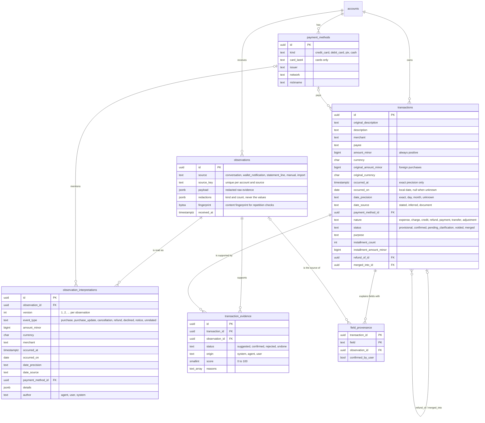

# Data model

Every table below belongs to one account: it has `account_id`, row-level security keyed by `current_account_id()`, and is reached through `Store.TenantTx`. References between tables of the same account are composite foreign keys on `(account_id, id)`, so a row can never point at another account's data. The application role cannot `DELETE` from any table; changes are recorded through status columns and the revision history.

## Rules the schema enforces

- **Evidence is immutable.** `observations` and `observation_interpretations` have no `UPDATE` privilege. A new reading of the same evidence is a new interpretation `version`; an observation without any interpretation is `pending_interpretation`.
- **One source identity, one observation.** `(account_id, source, source_key)` is unique: a repeated conversation message, notification or statement line cannot create a second observation.
- **No double counting.** An observation can be `confirmed` evidence of at most one transaction at a time (`transaction_evidence_confirmed_observation_idx`), and a transaction has at most one open link to the same observation. Links are never removed: they move to `rejected` or `undone`.
- **Amounts are positive magnitudes.** The `nature` gives the direction: `credit` and `refund` bring money back; the others take it out. Foreign purchases keep the original amount and currency next to the charged one; the two never share a currency.
- **Dates keep their precision.** `occurred_at` exists only for `exact`; `occurred_on` is null only for `unknown`; `month` dates sit on the first day of the month.
- **Merges keep both sides.** `status = 'merged'` exactly when `merged_into_id` is set, so the merged transaction and its evidence remain queryable and the merge can be undone.
- **Field provenance.** For each field of a transaction, `field_provenance` names the observation it came from and whether Rudolfo confirmed it; confirmed fields are protected from automatic overwrites. Categories carry their own status and origin in `category_allocations`.
